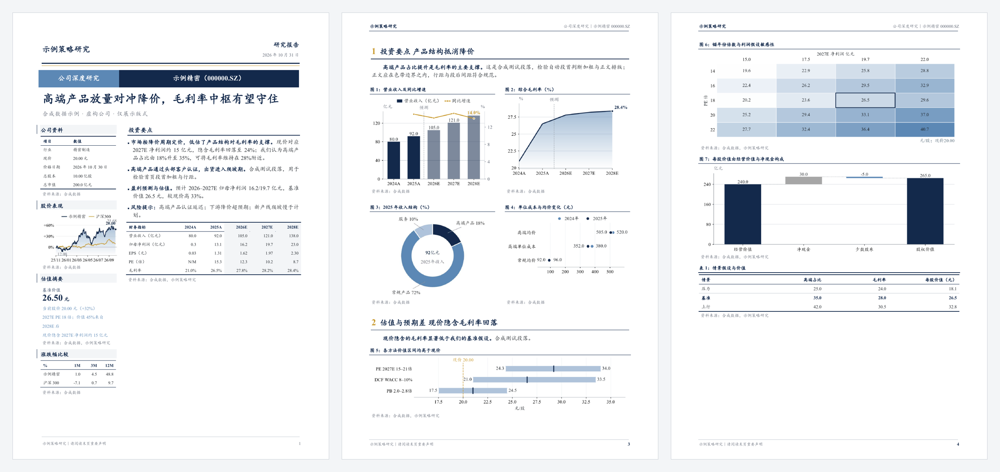
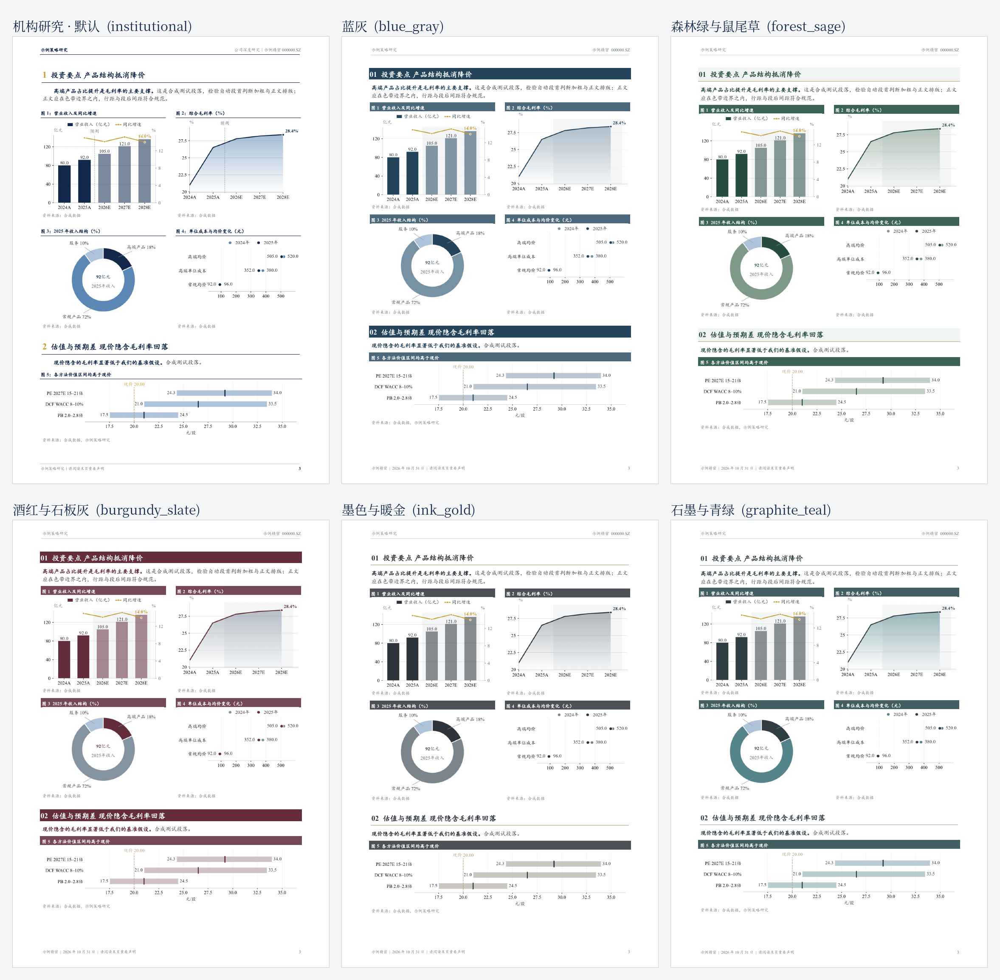

<div align="center">

# Equity Research Skill

### 从 Excel 估值模型到专业公司深度研报

面向 **A 股与港股** 的中文研究工作流 · **通用 Agent Skill**（Claude Code · Codex · 其他支持 SKILL.md 的 Agent）

[](skills/ah-equity-research/SKILL.md)
[](requirements.txt)
[](#preview)
[](#design)
[](#quick-start)

[效果预览](#preview) · [快速开始](#quick-start) · [核心能力](#features) · [风格与品牌](#design) · [使用文档](#docs) · [更新记录](CHANGELOG.md)

</div>

把已经完成的 Excel 估值模型，与行业资料、公司公告及可用的金融数据结合，形成有投资逻辑、有量化论证、有专业图表的中文公司深度报告。交付可编辑 **Word**、同版 **PDF** 和独立研究底稿。

研究围绕**行业格局 → 公司竞争力 → 投资逻辑 → 盈利与估值**展开。模型中的量价、利润率和现金流进入正文论证，完整财务预测与补充数据进入附录。

<a id="preview"></a>
## 看看交付效果

<p align="center">
  <a href="docs/assets/report-preview.png">
    
  </a>
</p>

<p align="center"><sub>由本项目排版工具生成的合成数据示例，点击查看大图。展示样式，不代表真实公司的研究结论。</sub></p>

| 交付物 | 你可以如何使用 |
| --- | --- |
| **Word 研究报告** | 继续编辑观点、原生表格、标题和附录，沿用统一样式 |
| **PDF 正式版** | 按最终分页阅读、审阅与分享 |
| **独立研究底稿** | 追溯资料链接、披露日期、模型单元格映射与补充测算 |

适合已有估值模型的公司深度研究、财报后研究更新，以及存量研报的图表和排版改进。

<a id="quick-start"></a>
## 快速开始

### 1. 安装 Skill

本项目采用开放的 `SKILL.md` 格式：一个文件夹包含工作流说明、参考规范和脚本，任何能读取文件、执行本地 Python 脚本的 Agent 都可以使用。

| Agent | 安装方式 |
| --- | --- |
| **Claude Code** | 把 `skills/ah-equity-research` 复制到 `~/.claude/skills/`（个人）或项目的 `.claude/skills/`；或运行 `npx skills add Ruoyu-Tianyi/equity-research-skill --skill ah-equity-research` |
| **Claude 应用（含桌面端）** | 将 `skills/ah-equity-research` 打包为 zip，在设置的技能页面上传 |
| **Codex** | 发送：`使用 $skill-installer，从 https://github.com/Ruoyu-Tianyi/equity-research-skill 安装 ah-equity-research，技能路径 skills/ah-equity-research`；或复制到 `~/.codex/skills/` |
| **其他 Agent**（Cursor、Gemini CLI、OpenClaw 等） | 复制到该 Agent 的技能目录；不支持技能目录时，在对话开头让 Agent 读取 `SKILL.md` 并按其指引执行 |

安装 Skill 不会自动安装 Python 依赖、字体或 Microsoft Word；首次使用请按下方“运行环境”完成准备。

<details>
<summary>运行环境与手动安装</summary>

下载或克隆仓库，把完整的 `skills/ah-equity-research` 文件夹复制到所用 Agent 的技能目录，保留其中的脚本、参考文档和资源文件。

```bash
git clone https://github.com/Ruoyu-Tianyi/equity-research-skill.git
cd equity-research-skill
python -m pip install -r requirements.txt
```

| 环境 | 要求 |
| --- | --- |
| Agent | Claude Code、Codex 或其他支持 SKILL.md 的 Agent；需能读取模型、执行本地脚本及访问所用资料 |
| Python | 3.10+；依赖 `openpyxl`、`python-docx`、`Pillow`、`matplotlib`；取A股行情可选 `tushare` |
| 字体 | KaiTi（楷体）与 Times New Roman；字体文件不随项目分发，放在工作区 `fonts/`（simkai.ttf、times*.ttf）即可自动发现 |
| 行情数据（可选） | Tushare Pro 账号；凭证放环境变量 `TUSHARE_TOKEN` 或本机 `config.local.json` |
| 内置 PDF 导出 | Windows + Microsoft Word 桌面版 |
| 其他导出环境 | 另接可用的文档导出引擎，并重新核验字体、字段和分页 |

</details>

### 2. 提供模型与研究时点

准备 Excel 工作簿、公司及证券代码、研究截止日。行业资料、公司公告、金融终端导出或已授权的数据接口都可以作为补充输入。

将下面的内容发给你的 Agent，替换方括号即可开始：

```text
使用 ah-equity-research 技能，生成一份中文公司深度研报。

公司与证券代码：[公司名称、代码、股份类别]
估值模型：[Excel 工作簿路径或附件]
研究截止日：[YYYY-MM-DD，或沿用模型原研究时点]
补充资料：[公告、行业资料、终端导出或可用接口]

围绕行业格局、公司竞争力和投资逻辑展开分析，
沿用原模型的预测与估值方法，将模型数据融入盈利与估值论证。
采用默认机构研究风格；中文楷体，英文及数字 Times New Roman。
重要经营与财务数据、有价值的补充图表整理到附录。

交付可编辑 Word、同版 PDF 和独立底稿。
```

### 3. 审阅并迭代

围绕投资论点、模型解释与最终页面提出修改，Skill 会延续已确定的研究时点、字体、配色和品牌偏好。例如：

```text
强化公司相对同行的成本优势，结合模型解释其对利润和估值的影响。
正文保留关键图表，把详细经营假设与完整财务预测放入附录。
```

<a id="features"></a>
## 核心能力

### 先想清楚，再动笔

写作前先完成研究底稿：核心研究问题、现价隐含条件与预期差、3–5张“主张—证据—机制—反证”论点卡，以及估值锚与价值构成。正文章节和论点只从底稿展开；成稿再由独立评审按七维度量表打分，未达门槛回到对应环节修订。

### 一份规格生成整本报告

全文写成一份 JSON 报告规格，`build_report.py` 先检查（研究底稿是否存在、首条要点是否说明预期差、大幅偏离现价是否有对账章节、失真倍数是否显示 N/M、图表来源是否齐全），再生成可编辑 Word；换公司不需要写装配代码。来源账本检查器拦截截止日后的信息。

### 让模型成为研究论证的一部分

从供需、竞争格局、产品与客户出发，将研究判断落到销量、价格、份额、成本、资本开支与现金流。估值章节解释利润基期、估值依据、情景差异和价值区间；详细模型检查保存在底稿。

### 用专业图表表达投资观点

图表从模型、来源数据与逐日行情绘制，按问题选图：规模与增速用柱线组合图，结构用环形图，趋势用渐变面积图，两期对比用哑铃图，估值用价值桥、区间图与敏感性热力图。预测期柱体变浅并以虚线标注；首页股价图使用逐日连续数据并叠加基准指数。图表标题采用“图 1：对象（单位）”的中文研报格式，中文楷体、英文及数字 Times New Roman 贯穿全文。

### 让正文易读，让附录可查

正文突出判断与证据，附录系统呈现经营驱动、财务预测、估值参数及补充研究。附录采用浅底深字标题、白底列头、细分隔线和重点行轻填充，保留完整数据与查阅层级。

### 专业用语与自动检查

内置研报用语规范：以“我们预计”为叙述主体，标题“类别：判断”，单位写入括号，资料来源统一为“机构，机构”格式。生成前自动拦截内部过程用语、截止日后的信息、估值输入时点错配、空白风险单元格和缺少反向风险的风险表；附录表格按年份表头从模型取数，避免错列。

### 保留简洁出处与完整底稿

图表下方只展示简短资料来源；完整链接、披露时间、原始定位及 Excel 单元格映射放入独立底稿。历史研究按截止日筛选可用信息，预测期间明确标识。

<a id="design"></a>
## 六套风格，同一研究标准

默认 `institutional`（机构研究）：海军蓝单主色、细线分隔与留白、三线表与浅灰预测列；封面为品牌栏、双色通栏与左右双栏（公司资料、股价表现、估值摘要、涨跌幅比较｜投资要点、风险提示、主要财务指标）；正文“1 / 1.1”编号、首行缩进，文末附重要声明。可在本机配置研究机构名称、英文名与 logo。

另有五套色带风格可选，配色、章节形式和间距可切换，字体与图表规范保持一致。下图为同一份合成数据报告的同一页在六套风格下的效果：



| 风格 | 配置名称 | 视觉特点 |
| --- | --- | --- |
| **机构研究 · 默认** | `institutional` | 海军蓝细线、三线表、浅灰预测列、中文研报封面 |
| **蓝灰** | `blue_gray` | 深蓝章节带、蓝灰图题、浅蓝灰表格 |
| **森林绿与鼠尾草** | `forest_sage` | 浅底深绿章节、柔和辅助色、稍舒展的行距 |
| **酒红与石板灰** | `burgundy_slate` | 酒红章节带、暖灰表格、紧凑正文 |
| **墨色与暖金** | `ink_gold` | 墨色标题、暖金细线、浅暖灰表格 |
| **石墨与青绿** | `graphite_teal` | 细线章节、青绿数据系列、略紧的段后间距 |

直接在对话中指定风格与研究名称：

```text
使用“墨色与暖金”风格，首页和页眉名称设为“示例策略研究”。
```

<details>
<summary>本机默认名称与脚本配置</summary>

在已安装 Skill 的根目录创建 `config.local.json`：

```json
{
  "research_brand": "示例策略研究",
  "research_brand_en": "SAMPLE STRATEGY RESEARCH",
  "brand_logo": "brand/logo.png",
  "brand_logo_header": "brand/logo-mono.png"
}
```

该文件已加入 Git 忽略规则，公共发布包不包含本机配置。单次指定的名称优先于默认值。

通过 Python 装配报告时，让文档和图表使用同一方案：

```python
from research_editorial_layout import EditorialReport, Theme
import chart_style as charts

style_name = "institutional"
charts.configure(theme=style_name)  # 创建图表前设置
report = EditorialReport(
    company="公司名称",
    ticker="证券代码",
    date="研究截止日",
    theme=Theme.preset(style_name),
    research_brand="示例策略研究",
)
```

上例需将 `skills/ah-equity-research/scripts` 加入 Python 模块搜索路径。品牌只作用于首页与页眉，保留公司、证券代码及报告类型的独立含义。完整参数见[风格与品牌说明](skills/ah-equity-research/references/style-presets.md)。

</details>

<details>
<summary>在本机生成风格预览</summary>

在仓库根目录执行：

```bash
python skills/ah-equity-research/scripts/preview_styles.py --output outputs/style-preview
```

生成五页合成数据 Word 示例和图表。在 Windows PowerShell 中导出 PDF：

```powershell
powershell -NoProfile -ExecutionPolicy Bypass -File "skills/ah-equity-research/scripts/export_word.ps1" -DocxPath "outputs/style-preview/研报风格预览.docx" -PdfPath "outputs/style-preview/研报风格预览.pdf"
```

</details>

<a id="docs"></a>
## 使用文档

| 你想了解 | 从这里开始 |
| --- | --- |
| 完整研究工作流 | [SKILL.md](skills/ah-equity-research/SKILL.md) |
| Excel 模型的读取与映射 | [模型约定](skills/ah-equity-research/references/model-contract.md) |
| 资料来源、接口与历史时点 | [数据来源](skills/ah-equity-research/references/data-sources.md) |
| 写作前的研究底稿 | [研究底稿](skills/ah-equity-research/references/research-brief.md) |
| 投资逻辑与估值论证 | [研究与估值](skills/ah-equity-research/references/research-and-valuation.md) |
| 专业研报表达 | [行文规范](skills/ah-equity-research/references/writing-style.md) · [用语与格式](skills/ah-equity-research/references/terminology.md) |
| 报告规格与生成命令 | [报告规格](skills/ah-equity-research/references/report-spec.md) |
| 章节结构、图表与附录 | [报告蓝图](skills/ah-equity-research/assets/report-blueprint.md) · [版式规范](skills/ah-equity-research/references/report-design.md) |
| 评级与目标价 | [评级体系](skills/ah-equity-research/references/rating-system.md) |
| 主题配色与自定义名称 | [风格配置](skills/ah-equity-research/references/style-presets.md) |
| 数字核对与最终页面验收 | [质量检查](skills/ah-equity-research/references/quality-gates.md) · [评审量表](skills/ah-equity-research/references/review-rubric.md) |

<details>
<summary>仓库结构与辅助工具</summary>

```text
skills/ah-equity-research/
├── SKILL.md                 # 研究工作流入口
├── agents/                  # Agent 平台元数据（如 Codex 的 openai.yaml）
├── assets/                  # 报告蓝图
├── references/              # 研究、估值、写作与设计规范
└── scripts/
    ├── build_report.py              # 报告规格(JSON) → 检查 → 可编辑 Word（v2主入口）
    ├── chart_templates.py           # 组合图/环形/面积/哑铃/价值桥/热力图/估值区间/逐日股价等模板
    ├── fetch_market_data.py         # Tushare 逐日行情、基准指数与涨跌幅（截止日前）
    ├── reverse_valuation.py         # 现价反推、价值拆分、敏感性网格
    ├── source_ledger.py             # 来源账本检查：截止日后信息、未登记来源
    ├── probe_data_sources.py        # 探测实际可用的数据接口与公告网站
    ├── inspect_model.py             # 盘点模型结构，提取公式与缓存
    ├── research_editorial_layout.py # 装配可编辑 Word
    ├── chart_style.py               # 图表字体、配色与导出
    ├── design_presets.py            # 六套风格参数
    ├── preview_styles.py            # 合成数据风格预览
    └── export_word.ps1              # Windows Word → PDF
```

</details>

## 常见问题

**这是可以直接运行的自动研报程序吗？**  
这是通用的 Agent Skill，可由 Claude Code、Codex 等 Agent 执行，包含研究工作流、写作规范与排版工具。Agent 需要结合实际模型和资料完成研究、核对与导出；辅助脚本负责各自的具体环节。

**需要金融数据 API 吗？**  
可以使用已有 CSV/XLSX 导出、公告与财报；有 Tushare Pro 账号时，`fetch_market_data.py` 可自动取首页股价图与涨跌幅所需行情。若需要金融终端或付费接口，使用你已有的账号与权限；仓库不附带数据凭证或通用接入承诺。

**会修改我的原始模型吗？**  
默认只读原模型，沿用原预测和估值方法。补充测算另行记录；`inspect_model.py` 读取已有公式与缓存，不负责计算 Excel 公式。

**可以在 macOS 或 Linux 使用吗？**  
可在满足依赖与字体条件的环境中使用研究和 Python 排版工具。仓库内置的 PDF 导出脚本依赖 Windows Word；其他平台需要另选导出引擎并验收页面。

**仓库里有真实公司的模型和报告吗？**  
公开内容为通用 Skill、工具与合成样式示例。实际模型、公司研究底稿、API 凭证和本机品牌配置不随仓库发布。

## 发展路线

- **研究质量**：吸收优秀开源项目的做法，强化正文的论证逻辑与中文表达。
- **版式设计**：更专业、更具设计感的排版，提供更多可选版式。
- **分步流程**：研究底稿 → 模型 → 估值 → 图表 → 成文分步执行，每步设检查点。
- **自动化估值建模**（远期）：通过公开信息或用户提供的 API 取数，自动搭建估值模型；关键假设可由用户给定，也可由 AI 提出并标注。

## 参与改进

欢迎通过 [Issues](https://github.com/Ruoyu-Tianyi/equity-research-skill/issues) 提交使用反馈，或通过 Pull Request 改进研究规范、数据适配与排版工具。复现材料请使用脱敏或合成数据；版式问题可附上运行环境、所选主题和页面截图。

---

<p align="center"><sub>先形成研究判断，再用数据与估值展开论证。</sub></p>
